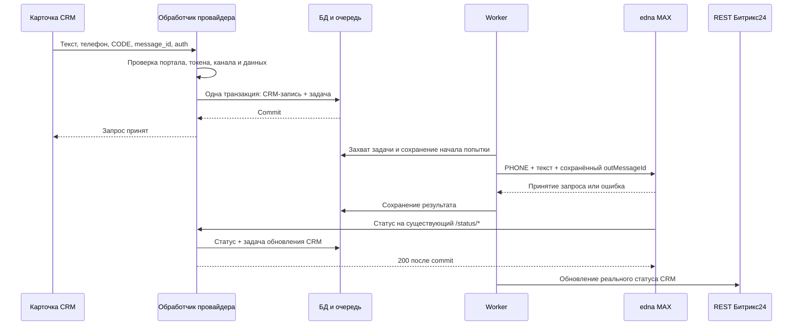

# Технический план: первое сообщение в MAX из CRM (#22)

Дата: 05.11.2026. Требования: [PRD, раздел 4.8](PRD.md#48-первое-сообщение-в-max-по-телефону-из-карточки-crm-22). Результаты проверок: [CRM_OUTREACH_PROGRESS.md](CRM_OUTREACH_PROGRESS.md). Подробная история переноса и доступов хранится в локальных материалах проекта.

Статус: план утверждён к началу работы, локальная основа с выключенной функцией реализуется. Текущее состояние и результаты проверок: [CRM_OUTREACH_PROGRESS.md](CRM_OUTREACH_PROGRESS.md). Ниже целевая реализация; наличие пункта плана не означает, что он уже выполнен. На сервер новые изменения не выкладывались.

## 1. Результат первой поставки

- Пользователь выбирает активный MAX-канал и телефон в блоке «Сообщение» контакта или сделки, отправляет текст, получает сообщение в MAX и видит реальный результат в CRM.
- У каждого активного канала свой отправитель; название содержит имя канала из настроек edna. Оформление SMS допустимо, фактической отправки SMS нет.
- Новый клиент не обязан писать первым. Ответ клиента проходит по существующему входящему маршруту в Открытую линию.
- Другие типы каналов подключаются через отдельные реализации возможностей. В первой поставке отправка из CRM разрешена только для явно определённого типа MAX.
- Иконка edna, отдельная отметка READ в CRM и перенос исходящего в историю Открытой линии остаются условными требованиями. Они не считаются проверенными возможностями.
- Подключение канала остаётся в существующей веб-форме edna. Регистрация CRM-отправителей, их обновление и удаление автоматические, в том числе для уже активных каналов после обновления приложения. Переключатели ниже внутренние, дополнительного пользовательского этапа настройки CRM нет. Возможное подтверждение нового scope выполняется штатным интерфейсом Битрикс24.

## 2. Что найдено в текущем коде

Срез: локальная ветка `master`, HEAD `770f5af`. В рабочей папке уже были правки README, PRD, review и файлы marketing; они сохраняются.

| Участок | Подтверждено кодом | Следствие для реализации |
|---|---|---|
| [probe22.py](../app/routers/probe22.py) | Разбирает форму провайдера; выставляет искусственный delivered через BackgroundTasks. По пробе 3 получены CODE, message_id, телефон, текст, bindings и auth.user_id. | Формат callback известен. Искусственный статус и непостоянные фоновые задачи в рабочую отправку не переносим. |
| [models.py](../app/models.py) | Нет CRM-message ↔ edna-request и состояния провайдера. Message хранит данные сообщений Открытых линий. | Для CRM добавляем отдельные записи; прежние строки и идентификаторы сохраняются. |
| [delivery_worker.py](../app/services/delivery_worker.py) | Есть постоянная очередь, атомарный захват задачи, backoff и восстановление processing через 300 секунд. Неизвестный task_type попадает в ветку исходящей отправки. | Переиспользуем инфраструктуру очереди; добавляем явную диспетчеризацию новых типов и отдельное восстановление незавершённой CRM-отправки. |
| Там же | enqueue_outgoing сам делает commit; тип получателя ищется по предыдущему входящему, иначе MAX_ID. После успеха создаётся Message. | Этот helper нельзя напрямую использовать для первого PHONE-сообщения и атомарного сохранения CRM-записи с задачей. Нужен новый helper без собственного commit. |
| [maxbot.py](../app/services/maxbot.py) | send_message_max поддерживает PHONE, но запрос не содержит собственного outMessageId. | Добавляем необязательный заранее сохранённый ID только для новой ветки; существующие вызовы не меняются. |
| [status.py](../app/routers/status.py) | Ищет Message по channel_id + edna_request_id, обрабатывает READ/ошибки для Открытой линии. Неактивный канал отклоняется. | Для CRM отдельная ветка сопоставления и постоянное сохранение статуса; старый путь сохраняется. |
| [api.py](../app/routers/api.py), [settings_page.py](../app/routers/settings_page.py) | Канал можно создать и отключить, переименования нет. Управляющие API опираются на переданный member_id. | Нужны переименование и подтверждённая сервером авторизация новых операций, запускающих синхронизацию провайдеров. Одного member_id недостаточно. |
| [install.py](../app/routers/install.py), [token.py](../app/services/token.py) | Хранят OAuth портала, app_token может отсутствовать. Отдельного признака CRM-функции/выданного scope нет. | Включение по порталу после проверки разрешений и подлинности callback. Не заменяем административный OAuth токеном обычного оператора из callback. |
| [main.py](../app/main.py) | Миграции выполняются при импорте; worker стартует при startup. | Не импортировать приложение для пассивных проверок. Миграцию новой схемы выполнять и проверять до старта worker. |

## 3. Предлагаемая схема обработки

Сбой обновления CRM повторяет только вызов Битрикс24. Он не ставит повторно задачу отправки текста в edna.

### Входящий callback провайдера

Новый постоянный адрес: `POST /crm/messages/send`.

1. Разобрать PHP-форму; JSON оставить для контролируемых проверок. Парсер `_parse_php_form` можно переиспользовать без изменения его поведения; перенос из handler в общий модуль делать только при необходимости.
2. Проверить ограничения размера и структуры, `module_id=crm`, `type=SMS`, обязательные CODE, message_id, телефон и непустой текст. Роботы и бизнес-процессы не входят в эту поставку.
3. Найти установленный портал по member_id и проверить application_token сравнением с сохранённым значением. Отсутствующий сохранённый токен не означает разрешение: до подтверждённого получения токена новая функция на таком портале выключена. При необходимости bootstrap выполняется через проверенную OAuth-сессию нашего приложения; токен из непроверенного callback не сохраняется как доверенный.
4. Найти провайдера по порталу + CODE; проверить принадлежность канала этому порталу, его активность, разрешённый тип и включение функции. Нельзя искать последний активный канал по одному sender, как в пробе.
5. Не принимать client_endpoint из callback для сетевых обращений; использовать доверенную запись портала. Токены callback не сохранять в payload очереди/истории и не подменять ими OAuth установки.
6. Нормализовать телефон без подстановки произвольного кода страны. Текст сохранить без обрезания и преобразований, меняющих смысл. Лимит edna для TEXT сейчас 4000 символов: превышение отклонять с понятной ошибкой; границу для эмодзи проверить отдельно. Стандартное поле CRM может иметь меньший лимит, это проверить на стенде, не обходить неподдерживаемым изменением интерфейса.
7. Атомарно сохранить CRM-запись, заранее созданный outMessageId и задачу. Успешное подтверждение callback возвращать после commit. При недоступности БД не отвечать успешным приёмом.
8. Дубликат с тем же ключом возвращает результат уже принятого сообщения. Тот же ID с изменённым телефоном/каналом/текстом отклоняется и логируется; одинаковый текст с новым ID разрешён.

Для корректно авторизованного, но неотправляемого сообщения сохраняем понятную причину и задачу статуса failed. Для чужого или неподписанного запроса не вызываем edna/Bitrix и не создаём запись от имени портала. Точное тело ответа для ошибок провайдера проверить в этапе 0: описания параметров метода недостаточно для подтверждения всех UI-ошибок.

После проверки подлинности и принадлежности повтор уже принятого CRM-message обрабатывается по существующей записи, даже если канал с тех пор отключён. Проверки доступности для новой отправки не должны превращать такой повтор в новую ошибку/новую отправку. Флаг выключения не отменяет право прочитать результат ранее принятого запроса после авторизации.

## 4. Данные и миграция

### Новые таблицы

| Таблица | Основные данные | Ограничения |
|---|---|---|
| `crm_message_providers` | portal_id, channel_id, provider_code, desired_state, sync_state, desired_revision, синхронизированная revision, последнее имя/handler, ошибка и время повторной синхронизации | UNIQUE(channel_id), UNIQUE(portal_id, provider_code); провайдер принадлежит каналу того же портала. Код не зависит от имени. |
| `crm_outgoing_messages` | portal_id, channel_id, provider_code, bitrix_message_id, bindings, actor_user_id, текст, нормализованный телефон и тип адреса, edna_out_message_id, состояние отправки, начало попытки, реальные статусы/время, ошибка, desired/applied revision статуса CRM | UNIQUE(portal_id, provider_code, bitrix_message_id), UNIQUE(channel_id, edna_out_message_id); индексы для статусного callback и неопределённых отправок. |
| `crm_message_status_events` | Ссылка на CRM-сообщение, статус edna, statusAt, requestId, безопасные сведения об ошибке, fingerprint и время получения | Уникальный fingerprint события в пределах сообщения. События хранятся независимо от успешности обновления CRM. |

JSON-данные можно хранить как Text по текущей конвенции проекта. Сырые auth и ключи в новые таблицы не попадают. Нужные поля очереди вычисляются из CRM-записи по внутреннему ID, а не из сохранённого пользовательского токена.

Код провайдера: `edna_max_<channel.id>`, чтобы сохранить уже проверенный `edna_max_9`. При повторном подключении после отключения создаётся новый Channel, следовательно новый провайдер; старые сообщения остаются связаны со старым каналом. Переименование не меняет CODE.

### Добавления к существующим таблицам

- `portals.crm_outreach_enabled`: по умолчанию false. Включение означает, что портал прошёл проверку scope, авторизации и миграции провайдеров. При удалении приложения сбрасывается.
- `message_delivery_tasks.dedup_key`: nullable, уникальный индекс для непустых значений. У старых задач остаётся NULL; их payload и task_type не меняются.
- Ключ задачи содержит вид операции, внутренний ID сообщения/провайдера и revision, если она нужна. Повтор enqueue одной операции не создаёт вторую задачу; повтор исполнения учитывает состояние CRM-записи.

Миграция добавочная. Старые Message, идентификаторы чатов, webhook-токены и SECRET_KEY не меняются. Новые записи Message для первого исходящего в CRM не создаём: их без данных Открытой линии нельзя передавать прежней статусной логике.

Вынести новую идемпотентную миграцию в предлагаемый `app/migrations/crm_outreach_v1.py`, вызвать до работы нового кода/worker. Использовать имеющиеся SQLAlchemy/PostgreSQL, без введения Alembic в эту задачу. Проверить новую БД, копию существующей схемы, повтор миграции и параллельный старт. Ошибку новой схемы не скрывать как «миграция пропущена»: частично готовый ORM может сломать и прежние запросы к Portal. До разрешённой выкладки сохранить резервную копию и подтвердить восстановление по процессу окружения.

## 5. Очередь, повторные попытки и статусы

### Новые типы задач

- `send_crm_to_edna`: отправка текста; ID CRM-записи в payload.
- `update_crm_status`: доставка текущего желаемого статуса в Битрикс24; старые revision пропускаются.
- `sync_crm_provider`: согласование присутствия, имени и HANDLER провайдера.

В `_process_one_task` нужны отдельные ветки этих типов. Неизвестный тип не должен попадать в `_execute_outgoing`. Старые send_to_bitrix/send_to_edna сохраняют прежнюю логику.

Новые enqueue-helper выполняют add/flush, но commit делает вызывающий сервис вместе с бизнес-записью. Текущие helper с внутренним commit для этого не подходят.

### Защита от повторной отправки

- До HTTP-вызова зафиксировать состояние `sending`, ID попытки и заранее созданный edna_out_message_id. Блокировка/атомарный переход разрешает только одну отправку этого CRM-message одновременно.
- Положительный ответ edna фиксируется отдельно от статуса доставки. Задача отправки завершается; задача статуса не может вызвать отправку текста.
- Ошибка до передачи запроса, для которой доказано отсутствие отправки, допускает повтор с backoff. Однозначный отказ авторизации/валидации становится failed без сетевых повторов. Не все HTTP 5xx означают, что сообщение не принято.
- Read timeout, частичная передача, обрыв после передачи запроса и сбой БД после возможного принятия edna переводят отправку в `uncertain`. Автоповтор выключен. Поздний статус по сохранённому ID может уточнить результат.
- В `_reset_stale_tasks` новая CRM-задача с начатой попыткой становится uncertain, а не pending. Задача, которая достоверно ещё не начала HTTP-передачу, может вернуться в очередь. Старые типы восстанавливаются по прежнему правилу.
- Поддержка своего outMessageId подтверждена документацией, но это не доказательство идемпотентности повторного POST. До включения таких повторов нужна проверка контракта edna. Описанная ошибка `duplicated` с окном 5 минут также не доказывает защиту произвольного повтора по ID.
- Для uncertain нужен видимый администратору диагностический результат: канал, CRM-message, outMessageId, время и причина. Не показывать «не доставлено», пока исход неизвестен. В первой поставке достаточно небольшого блока в настройках; автоматической кнопки повторной отправки здесь не добавляем. Сверка с edna/поддержкой производится по точному ID. Метод истории edna нельзя считать готовым поиском по outMessageId: в проверенной статье такой фильтр и поддержка MAX не подтверждены.

### Отображение статусов

| Подтверждённое событие | Состояние/факт у нас | Статус провайдера в CRM |
|---|---|---|
| Запрос сохранён, edna ещё не подтверждена | queued | queued |
| HTTP-ответ edna с outMessageId | accepted | Не повышаем до delivered; ждём подтверждённого статуса |
| SENT | sent_at / sent | sent |
| DELIVERED, если получен | delivered_at | delivered |
| READ | read_at и факт доставки | delivered; отдельного read у этого API нет |
| UNDELIVERED, CANCELLED, EXPIRED | Неуспешная доставка с исходным кодом | undelivered |
| FAILED или однозначный отказ до отправки | Ошибка обработки/отправки | failed |
| Неопределённый результат | uncertain | Сохраняется последний подтверждённый статус; диагностика администратору |

В истории этого MAX-канала наблюдались SENT и READ, но не DELIVERED; не ждать обязательного промежуточного события. READ подтверждает доставку, поэтому delivered в CRM допустим, но он не называется отметкой прочтения. Неизвестный новый статус сохраняется для диагностики и не повышает состояние автоматически.

В `/status/{webhook_token}` сначала сопоставить известный CRM-запрос по каналу и requestId. При совпадении сохранить событие, обновить желаемое состояние и поставить задачу CRM в одной транзакции; 200 после commit. При неуспешном сохранении CRM-события возвращать ошибку, чтобы edna повторила запрос. Если совпадения с CRM нет, сохранить существующее поведение Открытых линий.

Сопоставление существует до HTTP-отправки, поэтому ранний callback не теряется из-за отсутствия Message. Свой ID должен возвращаться edna неизменным; неожиданное несовпадение требует сверки, не автоматического нового POST.

События сохраняются с statusAt, но правило переходов не сводится к одному числовому рангу: READ/доставка не откатываются поздним SENT, а противоречивый terminal error после подтверждённого READ сохраняется как конфликт для проверки. Конкурентные события сериализуются по CRM-записи.

Обновления статуса в Битрикс24 выполняются последовательно для одного сообщения, читают последнюю desired revision. Ошибки транспорта/лимита повторяются; после неопределённого ответа повторяется последнее состояние. При раннем `ERROR_MESSAGE_NOT_FOUND` дать Битрикс24 время сохранить сообщение и повторить обновление с ограниченным backoff. Ответ проверять и по HTTP, и по полям error/result: текущего call_bitrix с одной raise_for_status для новой ветки недостаточно.

### Отключённые каналы и незавершённые сообщения

Новые отправки отключённого канала отклоняются, задачи, ещё не переданные в edna, отменяются с failed в CRM. Для уже переданных запросов сохраняются последующие реальные статусы, даже если канал отключён. Для этого ветка CRM должна уметь найти известный запрос по сохранённому webhook-токену неактивного канала; проверка активности прежней ветки Открытых линий не меняется.

Переход в sending сериализуется с отключением канала. Перед ним повторно проверяется активность; уже начавшуюся внешнюю передачу нельзя гарантированно отозвать отключением в интерфейсе. Этот случай должен отличаться от задачи, которая ещё ждала отправки.

Отдельно проверить, принимает ли Битрикс24 изменение статуса старого сообщения после удаления его провайдера. Если нет, локально факт сохраняется, провайдер отключённого канала ради статуса не регистрируется заново. Ограничение отображения такого результата нужно зафиксировать перед выпуском; нельзя одновременно обещать отсутствие отключённого отправителя и неподтверждённую платформой доставку всех его поздних статусов в CRM.

## 6. Провайдеры и управление каналами

Реестр возможностей в предлагаемом `app/services/crm_channels.py`: тип канала → поддержка отправки из CRM, адресации, текста и статусов; MAX реализован, остальные выключены. Не применять правило «всё, что не MAX_BOT, является MAX» из старого потока к новой функции.

Сервис `crm_providers.py` вычисляет желаемое состояние из установки портала, включения функции, активности и типа канала. Операции выполняются в контексте приложения с административными правами. Обычная отправка сотрудником не запускает регистрацию и не должна требовать user.admin.

| Изменение | Действие |
|---|---|
| Подключён активный MAX | После сохранения канала создать локальный provider и задачу синхронизации |
| Провайдер отсутствует | sender.add с устойчивым CODE и постоянным HANDLER |
| Провайдер уже есть | sender.update с нужным NAME/HANDLER; `ERROR_SENDER_ALREADY_INSTALLED` не означает обновление |
| Канал переименован | Сохранить новое имя и revision, обновить NAME без смены CODE |
| Канал отключён | Сначала локально запретить отправку; запланировать sender.delete |
| Сбой Битрикс24 | Сохранить ошибку и повтор синхронизации; отключённый канал не начинает отправлять из-за оставшегося пункта в CRM |
| Повторное открытие настроек администратором / восстановление после сбоя | Согласовать локальное желаемое состояние с sender.list и обновить данные; список возвращает только CODE, NAME/HANDLER подтверждаются update и проверкой интерфейса |
| Удаление приложения | Сбросить включение функции, отменить ещё не начатые CRM-отправки и локально отключить каналы; не обращаться с недействительным OAuth. Удаление удалённых отправителей проверить как поведение самой платформы |
| Переустановка / обновление разрешений | Проверить scope и авторизацию заново; зарегистрировать только реально активные каналы, не включать ранее отключённые автоматически |

Периодическое согласование в имеющемся worker обрабатывает сохранённые незавершённые синхронизации. Желаемая revision защищает от запоздалого add/update после отключения/переименования; операции одного provider сериализуются. При гонке после ответа повторно читается актуальное состояние и выполняется корректирующая операция.

Для CRM-MAX-03 добавить переименование: `PATCH /api/channels/{channel_id}` только для name, с текущим правилом уникальности без учёта регистра; форма редактирования в существующем стиле [STYLE_GUIDE.md](STYLE_GUIDE.md). Sender, ключи, тип, история и ID канала этой операцией не меняются.

Новые управляющие запросы и существующие create/disconnect в части включённой CRM-функции должны проверять OAuth-сессию на сервере. UI передаёт актуальную авторизацию из BX24 по HTTPS без query-параметров токена. На доверенном endpoint портала проверить app.info (ожидаемый CODE приложения, не просто успешный ответ), user.admin для управления и доступный scope без full=true. Ожидаемый CODE задаётся в серверной конфигурации окружения, предлагаемый параметр `BITRIX_EXPECTED_APP_CODE`; при его отсутствии новое административное управление не включается. Значение для стенда и промышленного приложения может различаться; из произвольного тела запроса оно не принимается. Действующая часть интеграции без CRM-функции не должна требовать нового scope.

Это отдельная локальная доработка границы новых операций, а не полный аудит/переписывание всех существующих API. Нельзя расширять внешние действия на основе одного member_id.

## 7. Переключатели и переход с пробы

Предлагаются глобальный `CRM_OUTREACH_ENABLED` по умолчанию выключен и сохранённое включение по порталу. До включения проверяются новая схема, авторизация, scope messageservice и готовность worker.

Аварийное выключение глобального флага останавливает приём новых отправок и исполнение ещё не начатых CRM-send задач. Задачи остаются на паузе; уже полученные статусы и их доставка в CRM продолжаются новым кодом. Флаг не является командой удаления данных или всех провайдеров.

Выборка worker исключает приостановленные CRM-send задачи, чтобы одна такая задача не блокировала старые задачи и не создавала цикл непрерывного повторного захвата.

Переход тестового `edna_max_9`:

1. Развернуть новый обработчик с выключенной отправкой; не удалять provider и его историю.
2. Через sender.update заменить HANDLER на постоянный адрес и согласовать NAME, сохранив CODE. При успехе записать провайдера в локальный реестр.
3. PROBE_22 выключить; старый адрес /probe22/send перестаёт ставить искусственные статусы. При необходимости временно оставить на нём переходной обработчик без отправки и искусственного delivered, чтобы поздний вызов не попал в старое поведение. Не включать его как второй независимый рабочий отправитель.
4. Включить функцию для тестового портала после проверок. Подтвердить логом новый адрес, уникальный message_id, один outMessageId и реальный статус.
5. После подтверждения отсутствия провайдеров со старым HANDLER удалить register/unregister и временный код отдельной правкой. Откат новой функции не возвращает искусственную доставку.

## 8. Карта изменений по файлам

| Файл / новый модуль | Что изменить |
|---|---|
| `app/models.py`, новый `app/migrations/crm_outreach_v1.py` | Модели, добавочная миграция, индексы, включение по порталу |
| Новый `app/routers/crm_messages.py` | Постоянный callback, строгая проверка запроса, атомарный приём |
| Новые `app/services/crm_outreach.py`, `crm_channels.py` | Нормализация, идемпотентность, состояние сообщения, возможности типов |
| Новый `app/services/crm_providers.py` | Реестр и синхронизация провайдеров, миграция проверенного CODE |
| Новый `app/services/crm_bitrix.py` | Вызовы messageservice с проверкой API-ошибок и результатом, независимым от отправки edna |
| Новый `app/services/crm_auth.py` | Проверка административных операций и подтверждённого контекста приложения |
| `app/services/maxbot.py` | Необязательный outMessageId для MAX, без изменения старых вызовов |
| `app/services/delivery_worker.py` | Явные task_type, атомарные helper новой ветки, uncertain и отдельные повторы статусов/регистрации |
| `app/routers/status.py` | CRM-ветка до прежнего обработчика статусов, сохранение событий и очереди |
| `app/routers/api.py`, `app/schemas.py`, `app/routers/settings_page.py` | Переименование, синхронизация жизненного цикла, авторизация новых операций, диагностический результат |
| `app/routers/install.py`, `app/routers/handler.py` | Проверка включения после установки/обновления; локальное выключение при деинсталляции. Не переписывать старую отправку через Открытые линии |
| `app/main.py`, `app/config.py`, `app/routers/probe22.py` | Миграция до worker, подключение роутера, переключатели, безопасный переход с пробы |
| `docs/db_schema.md`, `docs/DEPLOY.md`, `docs/CODEX_HANDOFF.md` | Схема новой ветки, включение/остановка/откат и актуальная точка продолжения |

## 9. Условные возможности: отдельные проверки

| Требование | Проверка и критерий |
|---|---|
| CRM-MAX-02, иконка | Исследовать настройки приложения и документированные возможности CRM. Проверенные sender.add/update не имеют поля иконки. Менять общую иконку приложения ради одного пункта без согласования нельзя. При отсутствии поддержки оставить стандартную. |
| CRM-MAX-06, прочтение | Внутренний READ сохраняется. Проверить документированный способ дополнительного отображения факта в CRM, стоимость разрешений и отсутствие дублей. Не обещать статус read у messageservice и не добавлять crm scope без согласования. |
| CRM-MAX-09, история Открытой линии | На отдельной пробе проверить imconnector.send.messages с известным chat.id и автором-сотрудником: исходное время, существующий диалог, новый диалог после ответа, отсутствие повторной отправки через OnImConnectorMessageAdd и дублей CRM-контактов. Не создавать фиктивное входящее или диалог по телефону вместо неизвестного MAX_ID. |

Эти проверки не выполнялись в ходе подготовки плана. При подтверждении возможности добавляются отдельные задачи; при ограничении платформы результат фиксируется в PRD. Изменение базового сценария или дополнительных прав согласуется до реализации.

## 10. Порядок реализации и приёмки

| Этап | Результат | Условие перехода |
|---|---|---|
| 0. Уточнение контрактов | Проверить формат ошибки callback, app_token и контекст обычного оператора, свой outMessageId, правила неоднозначного результата и удалённого provider со старыми сообщениями | Зафиксированы подтверждённые ответы либо безопасные ограничения. Нет предположения о гарантии exactly-once у внешнего API |
| 1. Основа с выключенной функцией | Новые модели/миграция, явный dispatcher очереди, выключенные флаги, тесты перехода старой схемы | Старые send_to_bitrix/send_to_edna и старые установки работают; новые типы понимают все запущенные worker |
| 2. Рабочая отправка и статусы | CRM-MAX-04…06: новый callback, PHONE TEXT, постоянный ID, защита от дублей/uncertain, сохранение событий и доставка статуса | Изолированные проверки и тест одного канала на стенде; реально получен текст в MAX, искусственного delivered нет |
| 3. Жизненный цикл каналов | CRM-MAX-01, 03, 07, 08: провайдеры активных каналов, переименование, несколько каналов, новые/старые установки, авторизация управления | Нет перекрёстной отправки; отключённый канал не отправляет; повторная синхронизация не плодит provider |
| 4. Условные возможности и регрессия | CRM-MAX-02, 06 (READ), 09: результаты трёх исследований, сквозной ответ клиента, старые MAX Bot/MAX, восстановление после сбоев | Выполнена обязательная приёмка PRD; условные возможности имеют решение о включении |
| 5. Выпуск | Инструкция для команды edna, план добавления messageservice и обновления установок, согласованный откат | Подтверждены версия, резервная копия, порядок действий и контрольные проверки промышленного окружения |

Каждый этап состоит из небольших проверяемых изменений. До реализации этапа 2 стендовая регистрация может выполняться контролируемым действием администратора; автоматический жизненный цикл добавляется в этапе 3. В master не отправлять незаконченные части, которые включают реальную отправку: push связан с выкладкой Amvera.

### Проверки кода и БД

- Использовать изолированную БД и синтетические токены; не импортировать app.main с рабочими настройками. HTTP-вызовы подменять на границе клиентов. Для транзакций, индексов и конкурентного захвата проверить PostgreSQL; одна SQLite-проверка этих свойств недостаточна.
- Проверить параллельный одинаковый callback: одна CRM-запись и одна задача. Сбой транзакции не оставляет принятого сообщения без задачи. Повтор с новым auth-токеном не обходит дедупликацию по бизнес-ID.
- Проверить свой PHONE и ID в запросе edna; отсутствие запроса MAX Bot; лимит текста и эмодзи; отключение до фактической отправки.
- Смоделировать timeout после возможной отправки, падение процесса и сбой commit после ответа. Нет автоматического второго POST; запись получает uncertain и может разрешиться поздним callback.
- Смоделировать ранний статус, повторы, READ перед SENT, противоречивые конечные статусы, HTTP 200 с полем error от Битрикс24, лимит REST и ранний MESSAGE_NOT_FOUND.
- Проверить независимость повторов CRM-status и edna-send, сериализацию обновлений одного сообщения, перезапуск и невозможность исполнения нового task_type старой веткой.
- Проверить чужой портал, неверный/отсутствующий app_token, отключённую функцию, неподдерживаемый канал и попытку управления без прав администратора.
- Проверить двойную синхронизацию, rename/disconnect во время удалённого вызова, отсутствие messageservice у старой установки и деинсталляцию. Секреты не попадают в очередь, логи и ошибки интерфейса.

Для будущих тестов достаточно стандартного unittest и механизмов подмены HTTP имеющегося httpx; необходимость дополнительных тестовых библиотек определить при реализации, сейчас ничего не устанавливается.

### Проверка на стенде с пользователем

Сначала одна отправка на согласованный тестовый телефон: выбран правильный канал, один текст дошёл в MAX, в CRM тот же текст и реальный результат. Затем новый для канала получатель, два канала, несколько телефонов, недоступный получатель, реальное прочтение, ответ клиента и продолжение в Открытой линии. Для каждого случая фиксировать время, CODE, CRM-message ID, outMessageId и очищенные логи. Не тестировать реальные отправки на клиентах без соответствующего согласования.

## 11. Выкладка и откат

Сейчас ни выкладка, ни миграция не выполняются. Следующий этап начинается с проверки контрактов и основы с выключенной функцией.

1. До будущей выкладки сохранить пользовательские правки отдельно от коммитов реализации; подготовить резервную копию БД и проверить процедуру восстановления. Не менять SECRET_KEY.
2. Выпустить схему и worker, понимающий новые типы, при выключенной CRM-функции. Проверить все реплики: старый worker трактует неизвестный тип как исходящий. Нельзя записывать новые задачи, пока такой worker ещё работает. Не считать выставленное число реплик доказательством отсутствия старого экземпляра во время смены версии.
3. Перевести тестового провайдера на постоянный HANDLER, выключить PROBE_22, проверить включение только тестового портала. Фиксировать GitHub-коммит и отдельный merge-хеш Amvera; проверить завершение сборки и работу новой ветки по логам.
4. В промышленном приложении messageservice добавляет команда edna по согласованному плану обновления клиентов. Для установок без нового разрешения сохраняется прежняя работа. Standalone crm scope пока не нужен и не добавляется автоматически.
5. При проблеме сначала выключить новые отправки, оставив новый код для статусов и разбора очереди. Не удалять автоматически записи provider/сообщений.
6. Перед откатом бинарной версии обработать или изолировать все новые pending/processing/status/sync задачи. Если остаются uncertain или ожидаемые callback, предпочтителен откат поведения флагом и исправление новым кодом. Старый worker не должен увидеть новые типы после возврата версии.
7. Сохранить корректный HANDLER: перед удалением нового роутера убрать/перенастроить его provider в контексте приложения. Простое выключение функции не делает безопасным возврат к коду без этого маршрута. Искусственный delivered пробы не восстанавливать.
8. Добавочные таблицы и поля при откате кода не удалять. Возможность быстрого отката Docker-сборки в Amvera и порядок промышленного отката остаются непроверенными; не обещать кнопку отката до подтверждения. Контрольные проверки включают старую интеграцию, а не один /health.

## 12. Источники и оставшиеся вопросы

Методы Битрикс24 получены через b24-dev-mcp в этом этапе; это справочник, реальные операции с порталом не выполнялись.

- [Регистрация](https://apidocs.bitrix24.ru/api-reference/messageservice/messageservice-sender-add.html), [изменение](https://apidocs.bitrix24.ru/api-reference/messageservice/messageservice-sender-update.html), [список](https://apidocs.bitrix24.ru/api-reference/messageservice/messageservice-sender-list.html), [удаление провайдера](https://apidocs.bitrix24.ru/api-reference/messageservice/messageservice-sender-delete.html): контракт реестра отправителей.
- [Статусы CRM](https://apidocs.bitrix24.ru/api-reference/messageservice/messageservice-message-status-update.html): допустимые состояния; read отсутствует.
- [app.info](https://apidocs.bitrix24.ru/api-reference/common/system/app-info.html), [user.admin](https://apidocs.bitrix24.ru/api-reference/common/users/user-admin.html), [scope](https://apidocs.bitrix24.ru/api-reference/common/system/scope.html): проверка контекста приложения, управления и фактически выданных прав. scope с full=true не проверяет права этой установки.
- [Сообщения коннектора](https://apidocs.bitrix24.ru/api-reference/imopenlines/imconnector/imconnector-send-messages.html): возможный механизм исследования истории; отсутствие повторной отправки им не гарантируется.
- [Отправка MAX](https://docs-pulse.edna.ru/docs/api/messages/regular-messages/sending-max): PHONE, свой outMessageId, лимит текста. Идемпотентность повторного запроса из этой статьи не установлена.
- [Статусный webhook edna](https://docs-pulse.edna.ru/docs/api/callback/get-status): requestId, statusAt, статусы и повторы доставки webhook.
- [История edna](https://docs-pulse.edna.ru/docs/api/messages/history): пока не подтверждена как средство сверки MAX по собственному outMessageId.

До реального включения остаются вопросы этапа 0: полный контракт ошибок callback, проверка токена существующей установки/обычного оператора, практическое поведение своего ID и неопределённого результата, поздние статусы после удаления provider. Условные возможности исследуются отдельно; их отсутствие не заменяет обязательную отправку и реальные статусы фиктивными.

## 13. Текущая реализация, 05.11.2026

Код этапов 1–3 реализован локально с выключенными по умолчанию флагами: callback, PHONE/TEXT, постоянный ID, настоящие статусы, uncertain, автоматический жизненный цикл provider, безопасное управление и диагностика формы. Изолированные проверки пройдены. Практические условия этапа 0 и приёмка этапов 2–3 на сервере остаются открыты; условные возможности этапа 4 не обещаны. Подробности и результаты: [CRM_OUTREACH_PROGRESS.md](CRM_OUTREACH_PROGRESS.md). Готовый порядок следующей проверки: [CRM_OUTREACH_ACCEPTANCE.md](CRM_OUTREACH_ACCEPTANCE.md). Ни push, ни выкладки этого кода не было.
